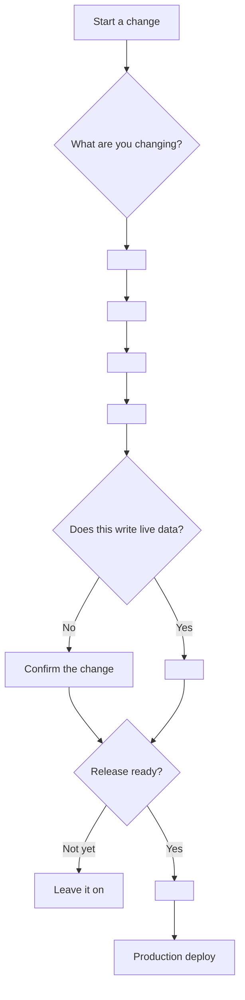
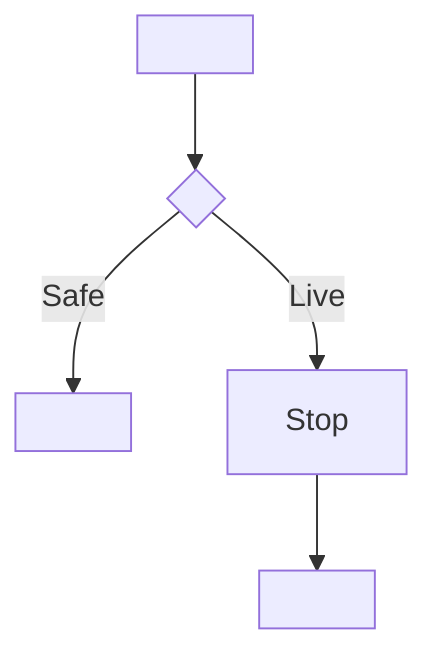
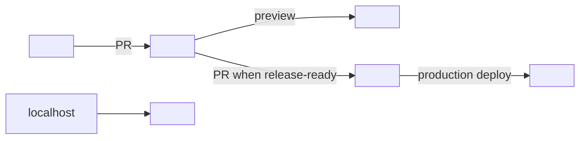

# Developer Runbook: <project-specific subtitle>

One sentence: how to test on a machine, preview, and ship without using the live database as a sandbox.

## Where each environment writes

| Environment | Git branch | App | Database | Safe for throwaway data? |
|---|---|---|---|---|
| Local | <branches> | <command and URL> | <datastore> | Yes or No |
| Preview | <branches> | <host> | <datastore> | Yes or No |
| Production | <branch> | <URL> | <datastore> | No |

State in one sentence after the table whether preview and production share a database.

## Scenario paths

Replace every placeholder with a confirmed path. Add a branch for each scenario the user confirmed. Delete any path that does not exist in this project.

### <Scenario name>

Numbered steps using this repo's commands. Include the local data reset and the pull-request base branch.

## Accidental live-data paths

| You were about to… | Do this instead |
|---|---|
| <risky action> | <safe action> |

## Branch and deploy map

Use one node when preview and production are the same database. Label that node with both environments.

## Related

- Link existing setup and deploy docs. Do not copy them.
