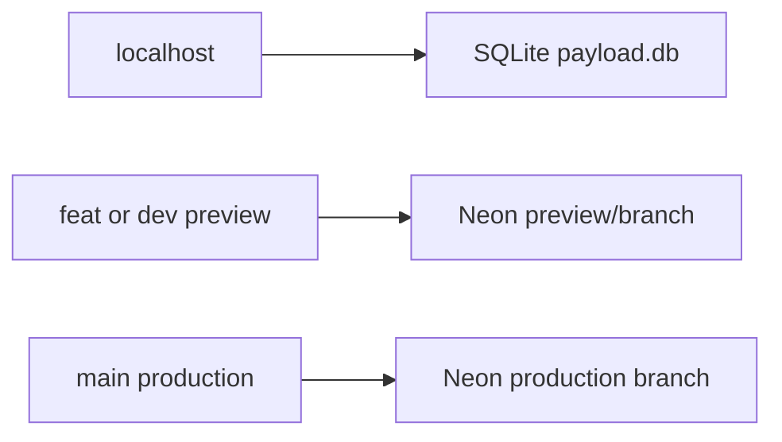

# Isolate Preview from Production (Neon branching)

## Why

Today [docs/setup.md](docs/setup.md) step 3 and [docs/developer-runbook.md](docs/developer-runbook.md) intentionally leave Preview Branching **off**, so Preview and Production share Neon `main` (content, schema, **users**). Neon’s documented practice is the opposite: enable **Create database branch for deployment → Preview only**; production stays on the production branch. Each preview Git branch gets a copy-on-write DB; later deploys of that Git branch reuse it. Auth rows branch with the database, so preview users diverge from production after the branch is created.

No adapter change: [payload.config.ts](payload.config.ts) already uses `POSTGRES_URL` / postgres `DATABASE_URL` and `push: false`. `pnpm build:vercel` (`payload migrate && next build`) applies schema to **whichever** connection the deployment injects.

## What you do in the dashboard (required; not code)

1. Vercel project **v0-rhyan-s-portfolio-website** → Storage / Neon integration → Connect.
2. Under **Create database branch for deployment**, check **Preview** only. Leave **Production** unchecked.
3. Redeploy an existing preview (or push a no-op) so Neon creates `preview/<git-branch>` and injects that deployment’s connection string.
4. Confirm Production env still points at Neon main (do not overwrite Production `POSTGRES_URL` with a preview branch URL).
5. Optional hardening (same change window): scope `PAYLOAD_SECRET`, `PREVIEW_SECRET`, and `CRON_SECRET` separately for Preview vs Production in Vercel env settings. Cookies are already host-scoped; separate secrets prevent a preview token from being valid if it ever hits production.

**Expect:** the first preview branch is a copy of production at branch time (including current admin users). Edits and new users on preview stay on that branch. Production `/admin` is unchanged until a `main` deploy migrates Neon main.

## Docs and skill (repo)

- [docs/setup.md](docs/setup.md): replace “leave branching unchecked / share main” with the Preview-only branching steps and a note that local stays SQLite (`POSTGRES_URL` unset).
- [docs/developer-runbook.md](docs/developer-runbook.md): environment table, mermaid, schema section, and “writes hit Neon main” copy. Preview CMS experiments are safe **on that preview branch**; they are not production. Production writes stay on production `/admin` or a `main` deploy.
- New [docs/architecture/adrs/ADR-003-neon-preview-branching.md](docs/architecture/adrs/ADR-003-neon-preview-branching.md): decision, citations ([Neon Vercel-Managed](https://neon.com/docs/guides/vercel-managed-integration), [Neon-Managed](https://neon.com/docs/guides/neon-managed-vercel-integration)), consequence that preview migrate no longer mutates production.
- One sentence in [docs/architecture/adrs/ADR-002-payload-cms.md](docs/architecture/adrs/ADR-002-payload-cms.md) pointing at ADR-003 for the DB topology (do not rewrite ADR-002).
- [.agents/skills/troubleshoot-payload-runbook/playbooks/live-db-leak.md](.agents/skills/troubleshoot-payload-runbook/playbooks/live-db-leak.md) and [playbooks/ship-checklist.md](.agents/skills/troubleshoot-payload-runbook/playbooks/ship-checklist.md): laptop `POSTGRES_URL` is still forbidden; preview admin is OK only after branching is on; if branching is off, treat preview writes as production.

## Out of scope

- Separate long-lived staging custom environment (later).
- Changing local SQLite default.
- Neon branch-per-preview cleanup policy (Neon deletes Vercel-managed preview branches when the deployment is deleted; Neon-managed when the Git branch is deleted).