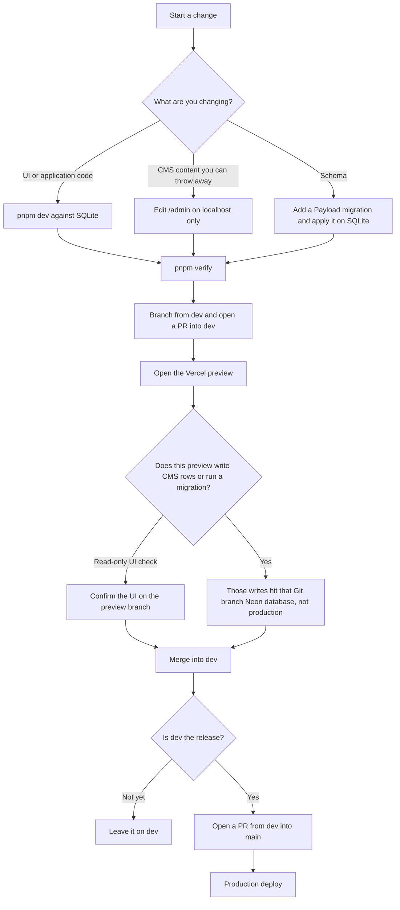
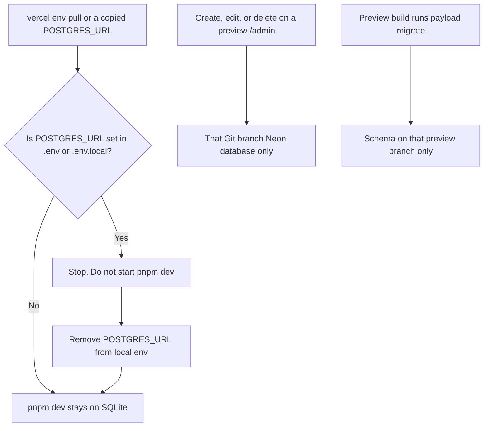
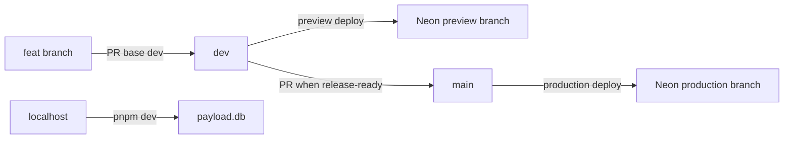

# Developer Runbook: Local Testing, Preview, and Production

How to test a change on your machine, preview it on `dev`, and ship it to production without treating the live database as a sandbox.

## Where each environment writes

| Environment | Git branch | App | Database | Safe for throwaway data? |
|---|---|---|---|---|
| Local | any | `pnpm dev` → `http://localhost:3000` | SQLite file `payload.db` (gitignored) | Yes |
| Preview | feature branches and `dev` | Vercel preview URL | Neon branch `preview/<git-branch>` | Yes, on that branch only |
| Production | `main` | [rhyan.dev](https://www.rhyan.dev) | Neon production branch | No |

Preview Branching is on for Vercel Preview only ([ADR-003](architecture/adrs/ADR-003-neon-preview-branching.md)). A preview deploy migrates and edits **that Git branch’s Neon database**, not production. The branch starts as a copy of production at creation time (including users); later preview writes stay on the branch. Production changes only on a `main` deploy or production `/admin`.

Local development stays off Neon only when `POSTGRES_URL` is absent. If that variable is set, Payload uses Postgres and your laptop writes to whichever Neon URL is in the file — often production. Leave it unset.

## Scenario paths



### Feature or UI change

1. Update `dev` and branch from it. Do not branch feature work from `main`.
   ```bash
    git fetch origin
    git checkout dev
    git pull
    git checkout -b feat/<short-name>
   ```
2. Keep local env on SQLite. Copy `.env.example` to `.env`, set `PAYLOAD_SECRET`, and leave `POSTGRES_URL` unset. `DATABASE_URL` should stay a file URL such as `file:./payload.db`.
3. Run the app and the gate:
   ```bash
    pnpm dev
    pnpm verify
   ```

    Site: `http://localhost:3000`. Admin: `http://localhost:3000/admin`. On a fresh SQLite file, create the first user immediately. That account exists only in `payload.db`.
4. Push the branch and open a pull request with base `dev`. Vercel builds a preview for the branch and, after merge, for `dev`.
5. On the preview, check layout and behavior. CMS experiments stay on that preview’s Neon branch. Do not assume those rows exist in production.
6. Merge into `dev`. When `dev` is the release, open a pull request from `dev` into `main`. Merging `main` deploys production. The production build runs `pnpm build:vercel` (`payload migrate && next build`) against the Neon **production** branch only.

### CMS content experiment

Edit content on localhost. Seed the local database when you need sample rows:

```bash
pnpm exec tsx scripts/seed-payload-now.ts
```

Delete `payload.db` and start `pnpm dev` again to reset local data. Do not commit `payload.db` or `.env`.

To change live content, use production `/admin` on rhyan.dev. Preview `/admin` edits that Git branch’s Neon database only.

### Schema change

1. Cut a `feat/...` branch from `dev` first. Do not commit schema work on `dev`.
2. Prefer generating SQL with `pnpm payload migrate:create <name>` ([Payload Migrations](https://payloadcms.com/docs/database/migrations)). Hand-written migrations must be idempotent.
3. Prove collections locally on SQLite (`pnpm dev` / seed). That does **not** prove the Postgres migration — the first preview `pnpm build:vercel` runs `payload migrate` against that Git branch’s Neon database.
4. If a migration uses Local API (`payload.create` / `update` / `delete`), **pass `req`** so it joins the migration transaction; otherwise use `db.execute` only. See Payload docs linked above.
5. Run preflight before the PR:
   ```bash
   pnpm preflight:schema
   ```
6. Open a PR with base `dev`. Review the migration SQL. When Vercel is green, skim preview `/admin` read-only, then merge.

**If something goes wrong** (wrong branch, migrate fail, Neon leak, empty Skills): run the project skill **`troubleshoot-payload-runbook`** and follow the matching playbook.

Postgres is configured with `push: false`. Local `pnpm dev` does not push schema to Neon. A preview build migrates the preview Neon branch. A production build migrates the production Neon branch.

### Hotfix

Branch from `main` only for a production-only fix. Open that pull request into `main`, then merge `main` back into `dev` so the integration branch does not drop the fix.

## Accidental live-database paths



| You were about to… | Do this instead |
|---|---|
| Run `pnpm dev` after `vercel env pull` | Remove `POSTGRES_URL` from `.env` and `.env.local`, then start the dev server |
| Seed or click around in preview `/admin` expecting it to update rhyan.dev | Preview writes stay on that branch; use production `/admin` for live content |
| Point `DATABASE_URL` at a `postgres://` Neon URL | Keep the local URL as `file:./payload.db` |
| Assume preview and production share users | They share a copy only at branch creation; later users and sessions diverge |

## Branch and deploy map



- Feature pull requests use `--base dev`.
- `--base main` is only for promoting `dev` to production, or for an explicit hotfix.
- Production on Vercel tracks `main`. Every other branch is a preview.
- Quality gate before merge: `pnpm verify` (test, typecheck, build).

## Related

- [Setup Guide](setup.md) — env vars and the Neon connection
- [ADR-002 Payload CMS](architecture/adrs/ADR-002-payload-cms.md) — why Postgres is the hosted database
- [ADR-003 Neon preview branching](architecture/adrs/ADR-003-neon-preview-branching.md) — preview DB isolation from production
- Cursor skill: `.agents/skills/troubleshoot-payload-runbook/` (also via `.cursor/skills` symlink) — recover from runbook mis-steps; enforcement plan in `references/enforcements.md`
